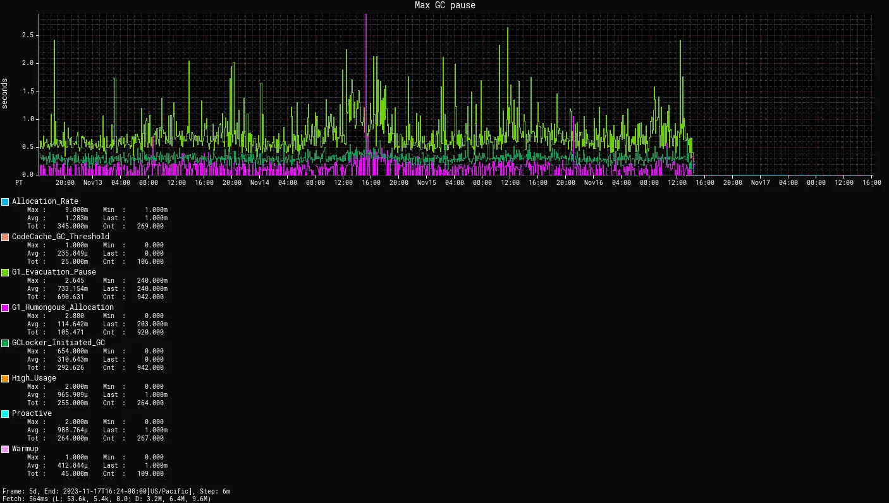

== {title}

{toc}

=== Flexible Constructor Bodies

```java
class ThreePartName extends Name {
	private final String middle;

	ThreePartName(String full) {
		// split "first middle last" on space
		var names = full.split(" ");
		// assign fields before `super`
		this.middle = names[1];
		// call `Name(String first, String last)`
		super(names[0], names[2]);
	}
}
```

=== Simplified Main

Get started quicker:

```java
// entire source file
// implicit `import module java.base`
void main() {
    var name = IO.readln("Please enter your name: ");
    IO.println("Nice to meet you, " + name);
}
```

(Execute with: `java Main.java`)

=== Multi-File Execution

Small programs can expand:

```
MyFirstJava
 ├─ Main.java
 ├─ Helper.java
 └─ Lib
     └─ library.jar
```

Run with:

```
java -cp 'Lib/*' Main.java
```

=== Stream Gatherers

Create custom stream operations:

```java
Stream.of("A", "C", "F", "B", "S")
	.gather(groups(2))
	.forEach(IO::println);

// [A, C]
// [F, B]
// [S]
```

=== FFM API

Allows interaction with

* native libraries (_foreign functions_)
* off-heap memory (_foreign memory_)

Replaces JNI, `ByteBuffer` and parts of `Unsafe` +
with a better, safer, and supported API.

=== Generational ZGC



=== Performance improvements

Every Java release improves performance, e.g.:

* +10%/+5% critical/max jOPS in SPECjbb 2015
* +70-75% requests/s on Helidon

(JDK 25 vs 21)

=== JFR improvements

JDK Flight Recorder got better:

* cooperative sampling (https://openjdk.org/jeps/518[JEP 518])
* method timing & tracing (https://openjdk.org/jeps/520[JEP 520])
* CPU-time profiling (https://openjdk.org/jeps/509[JEP 509], experimental)

=== Markdown in Javadoc

```java
/// Returns `true` if, and only if,
/// [#length()] is `0`.
///
/// @return `true` if [#length()] is `0`,
//          otherwise `false`
/// @since 1.6
@Override
public boolean isEmpty() { /* ... */ }
```
